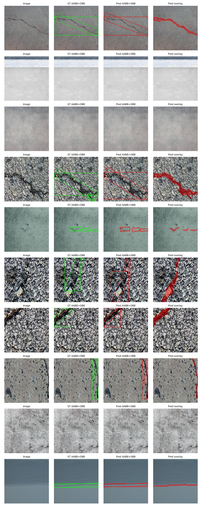
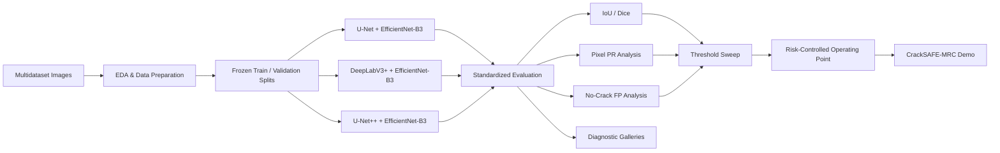
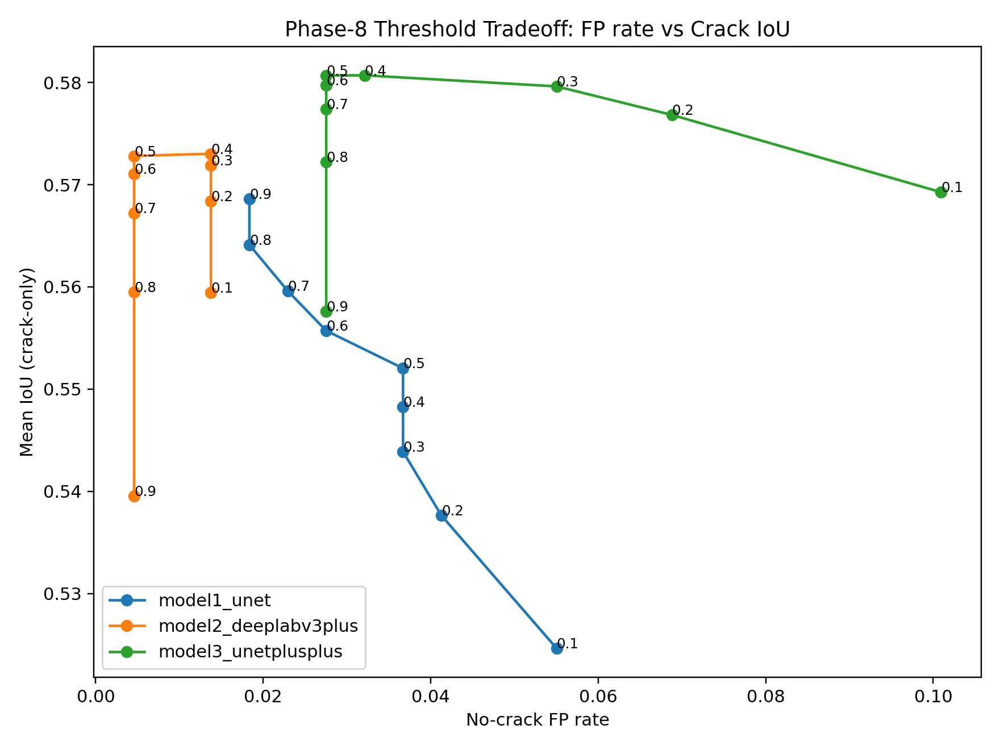

<div align="center">

<br/>

<code>COMPUTER VISION · STRUCTURAL IMAGERY · PIXEL SEGMENTATION</code>

<br/><br/>

# **CrackSAFE-MRC**

### **Multi-Model Wall Crack Segmentation Research**

<p>
A multidataset deep-learning study for detecting and segmenting wall cracks at pixel level —
with controlled model comparison, diagnostic evaluation, and threshold-aware operating-point selection.
</p>

<br/>

<a href="https://huggingface.co/spaces/abArman6979/Wallcrack">

</a>

 

<a href="https://github.com/mufrat-montasir/CrackSAFE-MRC">

</a>

<br/><br/>


<br/>


<br/><br/>



<sub>
Example validation predictions — ground-truth regions, predicted regions, and segmentation overlays.
</sub>

<br/><br/>

</div>

---

# **Research Objective**

Cracks in concrete and wall surfaces are often **thin, irregular, low-area structures** surrounded by large amounts of background.

That makes the problem more difficult than simply deciding whether an image contains a crack.

The goal of this project is to study **pixel-level crack segmentation** and answer several practical questions:

* Which segmentation architecture performs best on the same validation data?
* How well does each model localize thin crack structures?
* How should no-crack images be handled during evaluation?
* How much does the prediction threshold affect segmentation quality?
* Can false positives be reduced without sacrificing too much crack IoU?
* How do model failures differ across difficult surface textures and crack geometries?

Rather than relying on a single accuracy value, the project evaluates the models through **IoU, Dice, precision-recall behavior, no-crack false positives, qualitative overlays, error galleries, and threshold sweeps**.

---

# **Research Pipeline**



---

# **Model Families**

<div align="center">

## **01 · U-Net**

### EfficientNet-B3 Encoder


</div>

U-Net provides the first full segmentation baseline in the research pipeline.

The model uses an **EfficientNet-B3 encoder** and is evaluated through:

* Training and validation curves
* Pixel-level segmentation metrics
* Crack-only IoU
* Crack-only Dice
* No-crack false-positive behavior
* IoU distributions
* Precision-recall analysis
* Bounding-box / oriented-box diagnostics
* Worst-performing sample galleries
* Resolution-parity evaluation
* Threshold tuning

<div align="center">

<a href="https://github.com/mufrat-montasir/CrackSAFE-MRC/tree/main/Phase-1%2C2%2C3%28U-Net%20%2B%20EfficientNet-B3%20encoder%29">

</a>

</div>

---

<div align="center">

## **02 · DeepLabV3+**

### EfficientNet-B3 Encoder


</div>

DeepLabV3+ introduces a different segmentation strategy focused on stronger multi-scale contextual representation.

The experiment records:

* Training history
* Validation metrics
* Crack-area distributions
* Prediction-confidence distributions
* Pixel precision-recall behavior
* Bounding / oriented bounding-box overlays
* Crack-only IoU distributions
* Worst-case segmentation samples
* Model configuration
* Threshold analysis

<div align="center">

<a href="https://github.com/mufrat-montasir/CrackSAFE-MRC/tree/main/wallcrack-phase-4-deeplabv3">

</a>

</div>

---

<div align="center">

## **03 · U-Net++**

### EfficientNet-B3 Encoder


</div>

U-Net++ extends the encoder-decoder concept through nested skip pathways and becomes the strongest model in the final threshold sweep for crack-only overlap.

The experiment includes:

* Best and last checkpoints
* Training history
* Validation metrics
* Pixel PR analysis
* Crack-area diagnostics
* Confidence distributions
* IoU distributions
* Failure galleries
* Bounding-box diagnostics
* Threshold tuning

<div align="center">

<a href="https://github.com/mufrat-montasir/CrackSAFE-MRC/tree/main/wallcrack-phase-4B-unetpp-efficientnetb3-proto1-44">

</a>

</div>

---

# **Dataset Split**

The standardized evaluation protocol freezes the training and validation splits so every model is evaluated against the **same samples**.

| Split          |     Total | Crack Present | No Crack |
| -------------- | --------: | ------------: | -------: |
| **Training**   | **9,603** |         8,367 |    1,236 |
| **Validation** | **1,695** |         1,477 |      218 |

Split hashes are recorded in the Phase-6 protocol to make accidental split changes detectable.

<div align="center">

<a href="https://github.com/mufrat-montasir/CrackSAFE-MRC/blob/main/Phase-6/phase6_protocol%20%281%29.md">

</a>

</div>

---

# **Evaluation Philosophy**

A crack can occupy only a very small fraction of an image.

For that reason, **pixel accuracy alone can be misleading**.

A model could correctly classify most background pixels while still failing to capture the crack itself.

This project therefore uses several complementary measurements.

---

## **Intersection over Union**

For ground-truth crack pixels (A) and predicted crack pixels (B):

```text
IoU = |A ∩ B| / |A ∪ B|
```

Higher IoU means stronger overlap between the predicted crack mask and the true crack region.

---

## **Dice Score**

```text
Dice = 2|A ∩ B| / (|A| + |B|)
```

Dice provides another measure of segmentation overlap and is especially useful when foreground pixels are sparse.

---

## **Crack-Only Metrics**

Metrics are also reported specifically on validation images that actually contain cracks.

This prevents the large number of easy background pixels from hiding segmentation weaknesses.

---

## **Empty-Aware Evaluation**

No-crack samples are handled explicitly:

```text
Ground truth empty + prediction empty     → score = 1
Ground truth empty + predicted crack      → score = 0
Ground truth contains crack               → standard overlap metric
```

---

## **No-Crack False Positive Rate**

No-crack validation images provide a direct test of unwanted detections.

```text
FP Rate = no-crack images with predicted crack
          ------------------------------------
                  total no-crack images
```

This matters because a practical crack-detection system should not mark clean surfaces as damaged.

---

## **Pixel Precision–Recall Analysis**

Pixel-level precision-recall behavior is evaluated to study the foreground/background tradeoff under strong class imbalance.

---

# **Threshold-Tuned Results**

The final operating-point study evaluates thresholds from the segmentation probability maps rather than assuming that `0.50` is automatically optimal.

<div align="center">

## **Best Crack Segmentation Point**

</div>

| Model                         | Threshold | Crack-Only IoU | Crack-Only Dice |
| ----------------------------- | --------: | -------------: | --------------: |
| U-Net + EfficientNet-B3       |  **0.90** |     **0.5686** |      **0.7105** |
| DeepLabV3+ + EfficientNet-B3  |  **0.40** |     **0.5730** |      **0.7143** |
| **U-Net++ + EfficientNet-B3** |  **0.40** |     **0.5807** |      **0.7216** |

<div align="center">

<br/>


<br/>


</div>

---

# **Risk-Controlled Operating Point**

Maximizing crack IoU is not the only objective.

The Phase-8 policy also searches for an operating threshold that minimizes **false positives on clean images** while keeping crack-only IoU within **98% of the model's best crack-only IoU**.

| Model          | Selected Threshold |  Crack IoU | No-Crack FP Rate |
| -------------- | -----------------: | ---------: | ---------------: |
| U-Net          |           **0.90** |     0.5686 |        **1.83%** |
| **DeepLabV3+** |           **0.50** |     0.5728 |        **0.46%** |
| U-Net++        |           **0.50** | **0.5807** |            2.75% |

### Interpretation

**U-Net++** preserves the strongest crack segmentation overlap.

**DeepLabV3+** provides the lowest false-positive rate on no-crack images at the selected risk-controlled operating point.

This illustrates an important deployment lesson:

> **The model with the highest segmentation score is not automatically the best model for every operating requirement.**

---

<div align="center">

# **Threshold Tradeoff**



<sub>
Tradeoff between crack-only IoU and false-positive rate across candidate thresholds.
</sub>

<br/><br/>

<a href="https://github.com/mufrat-montasir/CrackSAFE-MRC/blob/main/Phase8_Threshold_Tuning_Operating_Point/phase8_threshold_policy.json">

</a>

</div>

---

# **Experimental Design**

A major goal of the later project phases is to make model comparison **fairer and easier to audit**.

The standardized protocol requires models to use:

```text
Same frozen train split
Same frozen validation split
Recorded split hashes
Comparable evaluation outputs
Crack-only reporting
Overall reporting
No-crack false-positive reporting
Pixel precision–recall analysis
Consistent artifact naming
Explicit threshold policy
```

This reduces the risk of declaring one model better simply because it was evaluated under a different data split or metric definition.

---

# **Diagnostic Analysis**

The repository does not stop at headline scores.

It stores visual and statistical artifacts that help answer **why a model succeeds or fails**.

### Training diagnostics

* Loss curves
* IoU curves
* Pixel-accuracy curves
* Precision-recall curves

### Distribution diagnostics

* Crack-only IoU histograms
* Overall IoU histograms
* Ground-truth crack-area distributions
* Predicted crack-area distributions
* Prediction-confidence distributions

### Qualitative diagnostics

* Segmentation overlays
* Bounding-box overlays
* Oriented bounding-box overlays
* Worst-performing sample galleries
* Crack-only failure galleries

---

<div align="center">

# **Prediction Diagnostics**


<sub>
Image → ground truth → predicted localization → segmentation overlay.
</sub>

</div>

---

# **Research Phases**

The repository preserves the development process rather than only keeping a final metric.

### **Phase 1–3 · Baseline & U-Net**

```text
Exploratory analysis
Data splitting
U-Net + EfficientNet-B3
Training history
Validation evaluation
Failure analysis
```

[Explore Phase 1–3 →](https://github.com/mufrat-montasir/CrackSAFE-MRC/tree/main/Phase-1%2C2%2C3%28U-Net%20%2B%20EfficientNet-B3%20encoder%29)

---

### **Phase 4 · DeepLabV3+**

```text
DeepLabV3+ experiment
EfficientNet-B3 encoder
Validation metrics
PR analysis
Confidence analysis
Detection overlays
```

[Explore DeepLabV3+ →](https://github.com/mufrat-montasir/CrackSAFE-MRC/tree/main/wallcrack-phase-4-deeplabv3)

---

### **Phase 4B · U-Net++**

```text
U-Net++ experiment
EfficientNet-B3 encoder
Validation artifacts
Checkpoint comparison
Diagnostic outputs
```

[Explore U-Net++ →](https://github.com/mufrat-montasir/CrackSAFE-MRC/tree/main/wallcrack-phase-4B-unetpp-efficientnetb3-proto1-44)

---

### **Phase 5 · Model Comparison**

```text
Cross-model comparison
Comparison tables
Aggregated metrics
Model ranking artifacts
```

[Explore Phase 5 →](https://github.com/mufrat-montasir/CrackSAFE-MRC/tree/main/Phase-5%20comapre)

---

### **Phase 6 · Evaluation Protocol**

```text
Frozen splits
Split hashes
Metric definitions
Reproducibility rules
Output naming convention
Threshold policy preparation
```

[Explore Phase 6 →](https://github.com/mufrat-montasir/CrackSAFE-MRC/tree/main/Phase-6)

---

### **Phase 7 · Diagnostic Parity**

```text
U-Net evaluation parity
256 × 256 evaluation
448 × 448 evaluation
Comparable diagnostic outputs
```

[Explore Phase 7 →](https://github.com/mufrat-montasir/CrackSAFE-MRC/tree/main/Phase7_Model1_Phase3R_Diagnostics_Parity)

---

### **Phase 8 · Threshold Selection**

```text
Threshold sweep
IoU / FP tradeoff
Best-IoU threshold
Best-Dice threshold
Risk-controlled operating point
```

[Explore Phase 8 →](https://github.com/mufrat-montasir/CrackSAFE-MRC/tree/main/Phase8_Threshold_Tuning_Operating_Point)

---

# **Repository Map**

```text
wallCrackWith2datasets/
│
├── Phase-1,2,3(U-Net + EfficientNet-B3 encoder)/
│   ├── EDA/
│   ├── training history
│   ├── model checkpoints
│   ├── validation metrics
│   ├── IoU / loss / PR plots
│   └── prediction diagnostics
│
├── wallcrack-phase-4-deeplabv3/
│   ├── DeepLabV3+ artifacts
│   ├── validation metrics
│   ├── confidence diagnostics
│   ├── PR analysis
│   └── prediction galleries
│
├── wallcrack-phase-4B-unetpp-efficientnetb3-proto1-44/
│   ├── U-Net++ checkpoints
│   ├── training history
│   ├── validation metrics
│   ├── PR analysis
│   └── diagnostic figures
│
├── Phase-5 comapre/
│   └── model comparison artifacts
│
├── Phase-6/
│   ├── evaluation protocol
│   ├── reproducibility configuration
│   ├── run manifest
│   └── split summary
│
├── Phase7_Model1_Phase3R_Diagnostics_Parity/
│   ├── unet_efficientnetb3_eval256/
│   └── unet_efficientnetb3_eval448/
│
├── Phase8_Threshold_Tuning_Operating_Point/
│   ├── threshold sweep
│   ├── threshold curves
│   ├── tradeoff plot
│   └── threshold policy
│
└── README.md
```

---

# **Technology & Research Tools**

<div align="center">


<br/><br/>


<br/>


<br/>


</div>

---

# **CrackSAFE-MRC Demo**

The research is also represented through a Hugging Face Space.

<div align="center">

<br/>

<a href="https://huggingface.co/spaces/abArman6979/Wallcrack">

</a>

<br/><br/>

<sub>
The Space may require a cold start after periods of inactivity.
</sub>

</div>

---

# **Current Repository Scope**

This repository is primarily a **research artifact archive**.

It currently emphasizes:

* Trained model checkpoints
* Evaluation reports
* Frozen split information
* Diagnostic figures
* Model-comparison outputs
* Threshold-tuning artifacts
* Reproducibility metadata

It is not currently organized as a single installable Python package or one-command training application.

That distinction is intentional in this README so that the repository is represented accurately.

---

# **Limitations**

Several challenges remain important when interpreting the results.

### Thin-structure segmentation

Cracks may occupy only a very small percentage of the image, creating severe foreground/background imbalance.

### Surface variability

Textures, joints, stains, shadows, edges, and surface damage can visually resemble cracks.

### Dataset dependence

Performance on the evaluation datasets does not guarantee the same performance on unseen buildings, materials, cameras, lighting conditions, or geographic environments.

### Threshold dependence

Binary segmentation quality changes with the probability threshold, which is why threshold selection is explicitly studied rather than hidden.

### False positives matter

A model that detects cracks well but repeatedly marks clean walls as damaged may not be appropriate for real inspection workflows.

---

# **Future Work**

Possible next steps include:

### Dataset expansion

* Add more construction materials
* Increase lighting diversity
* Add more no-crack surfaces
* Test additional external datasets

### Model research

* Transformer-based segmentation
* SegFormer
* DeepLab variants
* Attention-enhanced U-Net architectures
* Ensemble experiments

### Evaluation

* Cross-dataset generalization
* Confidence calibration
* Uncertainty estimation
* Precision/recall operating points
* Boundary-sensitive crack metrics

### Application layer

* Upload-and-segment interface
* Crack measurement
* Severity estimation
* Crack-length estimation
* Crack-width analysis
* Inspection-history tracking

### Deployment

* Consolidated inference pipeline
* Model export
* Optimized inference
* API serving
* Mobile-friendly inspection interface

---

# **Research Takeaway**

<div align="center">

### **Segmentation quality is only part of the problem.**

</div>

The experiments show why a crack-segmentation system should not be judged by a single number.

A strong evaluation also needs to ask:

```text
How accurately is the crack localized?

How does the model behave on clean surfaces?

Which failures are being hidden by aggregate metrics?

How sensitive is the model to its probability threshold?

What operating point makes sense for the intended application?
```

That is why this repository includes not only model checkpoints, but also **diagnostic galleries, crack-only metrics, no-crack analysis, standardized evaluation, and threshold policies**.

---

<div align="center">

<br/>

# **CrackSAFE-MRC**

### *Wall crack segmentation through controlled experimentation, diagnostics, and model comparison.*

<br/>

<a href="https://huggingface.co/spaces/abArman6979/Wallcrack">

</a>

 

<a href="https://github.com/abarman079">

</a>

<br/><br/>

**Python · PyTorch · Segmentation Models PyTorch · EfficientNet-B3 · U-Net · DeepLabV3+ · U-Net++**

<br/><br/>

<code>RESEARCH / COMPUTER VISION / STRUCTURAL IMAGE ANALYSIS</code>

<br/><br/>

</div>
